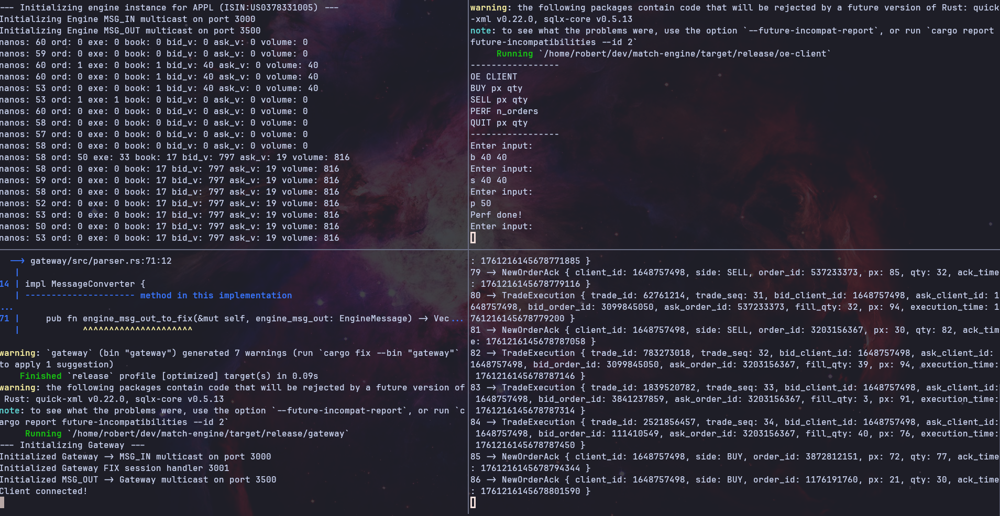
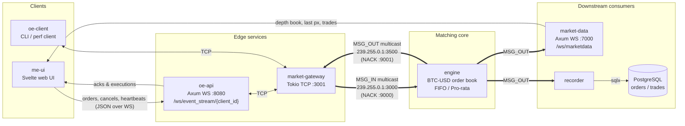
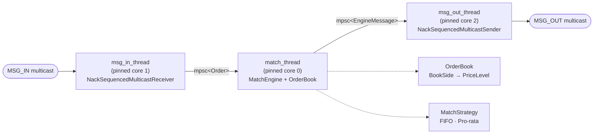

# Trade Matching Engine

Experimental trade matching engine written in Rust.



## Architecture



All engine I/O is sequenced UDP multicast with NACK-based retransmission (`common::transport`). Every downstream service subscribes to the same `MSG_OUT` stream, so the engine never needs to know who is listening.

### Engine internals



| Crate | Role |
|---|---|
| `engine` | Core matching engine: three core-pinned threads around a single-threaded order book |
| `market-gateway` | Bridges TCP order entry clients onto the engine's multicast bus and fans engine output back out |
| `oe-api` | WebSocket order entry API for the UI; routes acks and executions to each client |
| `market-data` | Builds the market data book from `MSG_OUT` and streams it to the UI over WebSocket |
| `recorder` | Saves orders and trades from `MSG_OUT` to PostgreSQL |
| `oe-client` | Interactive CLI and load-test client |
| `common` | Shared types, zero-copy serialization, ring buffers, sequenced multicast transport |
| `me-ui` | SvelteKit frontend |

## Features
- Match Engine - FIFO & Pro rata order matching
  - Limit order
  - Cancel
  - Ack
  - Executions
  - Self Match Prevention
- Market Data Distributor - Consumes UDP engine data & provides websocket feeds to frontend clients
    - Bid/Ask 10 depth book
    - Last trade px
    - Last 10 trades
- Match Engine Gateway - TCP clients to engine multicast
- Svelte Frontend - Web UI
- Order Entry Test Client
  - Bid/Ask orders and random perf orders

## Performance
- 600k orders/sec - i7 32GB RAM loopback UDP MTU 9000


## Usage

### Startup

Start the Matching Engine & API

```
 cargo run --release --bin engine
 cargo run --release --bin gateway
 cargo run --release --bin market-data
 cargo run --release --bin oe_client
```

1. The engine runs on port `3000` by default.
1. The engine gateway runs on port `3001` by default.
1. The engines order book is empty on start up.

### Order Entry

Orders can be submitted via the oe_client

```
OE CLIENT
BUY px qty
SELL px qty
CANCEL side order_id
PERF side n_orders
QUIT
```

The engine will ACK new orders & report executions (both sides get an execution).

```
Enter input:
b 30 30
Enter input:
Response: NewOrderAck(NewOrderAck { client_id: 492777011, side: BUY, order_id: 580547781, px: 30, qty: 30, ack_time: 1741038358998959369 })
s 30 30
Enter input:
Response: NewOrderAck(NewOrderAck { client_id: 492777011, side: SELL, order_id: 3939795387, px: 30, qty: 30, ack_time: 1741038362923362442 })
Response: TradeExecution(TradeExecution { trade_id: 2669498913, trade_seq: 1, bid_client_id: 492777011, ask_client_id: 492777011, bid_order_id: 580547781, ask_order_id: 3939795387, fill_qty: 30, px: 30, execution_time: 1741038362923374924 })
Response: TradeExecution(TradeExecution { trade_id: 2669498913, trade_seq: 1, bid_client_id: 492777011, ask_client_id: 492777011, bid_order_id: 580547781, ask_order_id: 3939795387, fill_qty: 30, px: 30, execution_time: 1741038362923374924 })
```

The OE Client can also perform perf (client logging is turned off during perf runs)

```
Client:
Enter input:
p 1000000
Perf done!

Engine logs:
nanos: 345 ord: 186104 exe: 140087 book: 152942
nanos: 218 ord: 178412 exe: 134083 book: 195824
nanos: 147 ord: 184255 exe: 138146 book: 240448
nanos: 146 ord: 1582   exe: 1198   book: 240823
```

## Building

If desired, you can build the engine yourself. You will need a working `Rust` and `Cargo`
setup. [Rustup](https://rustup.rs/) is the simplest way to set this up on either Windows, Mac or Linux.

Once the prerequisites have been installed, compilation on your native platform is as simple as running the following in
a terminal:

```
cargo build --release
```

## License

The project is licensed under the [MIT license](LICENSE) and includes this as the default project license.